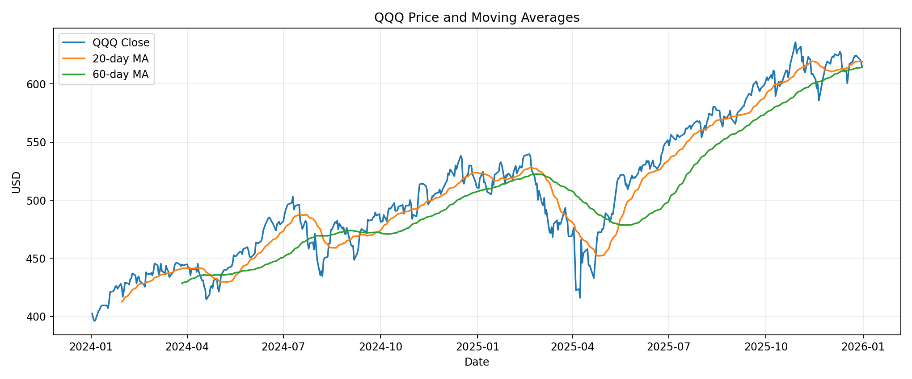
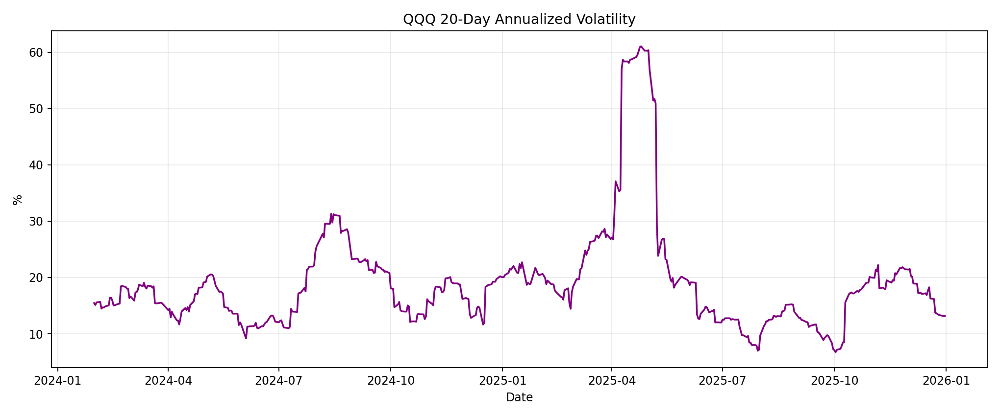
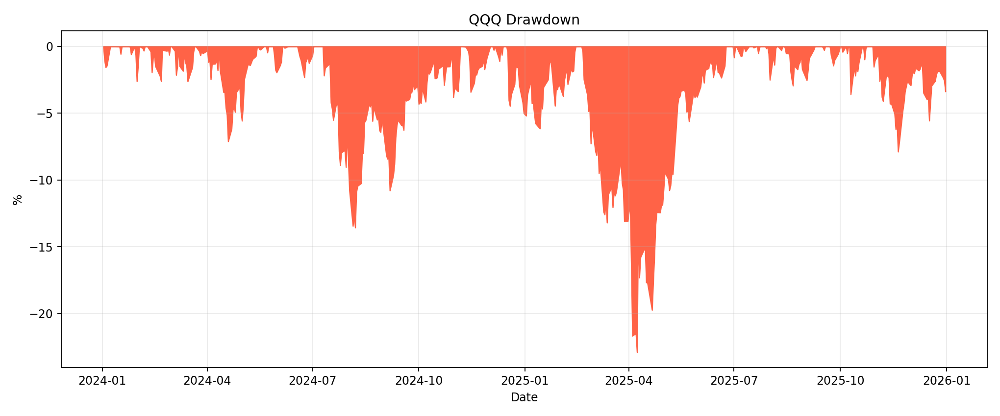
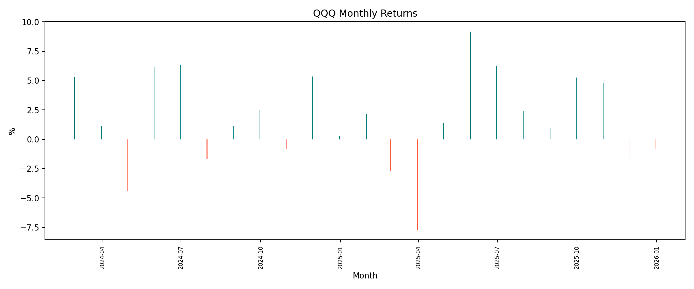

# QQQ 가격 트렌드 분석 리포트

> 학습 목적이며 투자 권유가 아닙니다.

## 1. 분석 주제 및 선정 이유
QQQ의 일별 가격으로 추세, 변동성, 하락 위험을 분석한다.

## 2. 분석 질문
1. 기간 전체 가격 흐름은 어떠한가?
2. 20일과 60일 이동평균은 어떤 추세를 보이는가?
3. 변동성과 최대 낙폭이 큰 시점은 언제인가?
4. 월간 수익률의 상승과 하락 패턴은 어떠한가?

## 3. 데이터 설명
- 기간: 2024-01-02 ~ 2025-12-31
- 데이터 포인트: 502개
- 출처/수집: Yahoo Finance 시세를 yfinance로 수집
- 컬럼: Date, Open, High, Low, Close, Adj Close, Volume

## 4. 데이터 정제
날짜 정렬, 숫자형 변환, 날짜와 종가 결측 행 삭제, 중복 날짜 제거를 수행했다. 급등락은 실제 시장 움직임일 수 있어 임의로 삭제하지 않았다.

## 5. 분석 방법
20일 및 60일 이동평균, 일간 수익률, 20일 연율화 변동성, 누적 최고가 대비 낙폭, 월간 수익률을 적용했다.

## 6. 시각화

## 7. 인사이트
### 인사이트 1
- 관찰: 시작 종가 $402.59, 종료 종가 $614.31, 단순 변화율 52.59%
- 해석: 전체 방향은 보이지만 중간 위험과 배당을 모두 설명하지 못한다.
- 행동: 이동평균, 변동성, 낙폭을 함께 본다.

### 인사이트 2
- 관찰: 최대 일간 상승은 2025-04-09 12.00%, 최대 하락은 2025-04-04 -6.21%
- 해석: 일부 극단적 거래일이 위험에 큰 영향을 줄 수 있다.
- 행동: 해당 날짜 원인은 별도 신뢰 가능한 뉴스 출처로 검증한다.

### 인사이트 3
- 관찰: 최대 낙폭은 2025-04-08 -22.88%
- 해석: 전체 수익률이 양수여도 보유 중 큰 하락을 경험할 수 있다.
- 행동: 기간을 바꿔 결론의 민감도를 확인한다.

## 8. 결론 및 한계
추세와 위험 지표를 함께 봐야 QQQ의 움직임을 균형 있게 설명할 수 있다. 단일 ETF만 분석했고 환율, 금리, 구성 종목 실적 등 외부 변수를 반영하지 않았다. 과거 데이터는 미래 성과를 보장하지 않는다.

## 9. AI 사용 로그
- 사용 작업: 코드 초안, 시각화 구성, 문장 구조화
- 사용 이유: 반복 작업 절감과 대안 탐색
- 검증 방법: 데이터 개수, 기간, 결측치, 계산 재실행, 이미지 4개 확인
